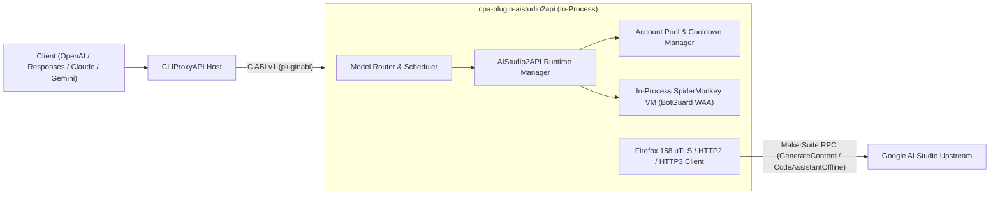

# cpa-plugin-aistudio2api (AIStudio2API for CLIProxyAPI)

<p align="center">
  <strong>简体中文</strong> | <a href="./README_EN.md">English</a>
</p>

<p align="center">
  <a href="https://github.com/Mag1cFall/AIStudio2API"></a>
  <a href="https://github.com/router-for-me/CLIProxyAPI"></a>
  <a href="./LICENSE"></a>
</p>

> **项目说明与致谢（Upstream Attribution）**  
> 本项目是将 **[Mag1cFall/AIStudio2API](https://github.com/Mag1cFall/AIStudio2API)** 完整移植为 **[CLIProxyAPI](https://github.com/router-for-me/CLIProxyAPI)** 原生动态库插件（Native C ABI v1 / Schema v10）的开源项目。  
> 核心协议栈（MakerSuite `GenerateContent`、Build `CodeAssistantOffline`、Firefox/uTLS 浏览器指纹伪装、进程内 SpiderMonkey BotGuard WAA 虚拟机、多账号冷却调度与多协议转换）均源自 **[Mag1cFall/AIStudio2API](https://github.com/Mag1cFall/AIStudio2API)**，遵循 [MIT License](./LICENSE)。

> [!WARNING]
> **关于 `-build` 代码助手模型的风控保护说明（`v1.2.5` 默认禁用保护）**  
> 自 `v1.2.4` 起（同步上游 [`Mag1cFall/AIStudio2API`](https://github.com/Mag1cFall/AIStudio2API) 与 [#11](https://github.com/jianli9158/cpa-plugin-aistudio2api/issues/11)），插件默认关闭全部 `-build` 后缀代码助手（Applet）模型（`enable_assistant_models: false`），原因如下：
> 1. **底层机制风险**：`-build` 代码助手模型在底层需要通过 `CreateApplet` / `SaveApplet` 在账号的 Google Drive 中频繁创建名为 `Untitled` 的 AI Studio Applet 应用，并通过提示词强行覆盖 Applet 内置的文件修改工具以模拟外部 Function Calling。
> 2. **触发 Google 集中风控封禁**：近期 Google 针对 AI Studio Applet 加强了自动化安全审查。当在 Claude Code、Codex、Cline 等 Agent 工具中使用 `-build` 模型时，Agent 的系统提示词、终端命令或敏感代码会被作为 Applet 源码/快照上传，极易触发 Google 的恶意软件与滥用检测，导致 Google 账号被永久限制访问 AI Studio（跳转 `servicerestricted`，显示“您对该产品的使用权限已被暂停”）。
> 3. **安全使用建议**：日常请直接使用无 `-build` 后缀的 **Playground 通道模型**（如 `gemini-3.8-flash`、`gemini-4-argon`、`gemini-3.1-pro-preview` 等）。如确需在**测试账号**中使用 `-build` 通道，可在插件配置中显式开启 `enable_assistant_models: true`。

---
## 核心特性

- **进程内 SpiderMonkey BotGuard WAA 引擎**：直接将 Firefox 158 SpiderMonkey C++ 引擎静态链接进动态库（`.dylib` / `.so` / `.dll`），在 CLIProxyAPI 进程内毫秒级完成 Google BotGuard WAA 字节码解释与签名生成，无需安装 Python、Node.js、Playwright 或无头浏览器。
- **Playground + Build 通道完整支持**：
  - **Playground 通道**（`MakerSuiteService/GenerateContent`）：支持 `gemini-3.8-flash`、`gemini-4-argon`、`gemini-2.5-pro`、`gemini-2.5-flash`、Imagen、Veo、TTS、Decision 等全部模型及思考等级后缀（`-minimal` / `-low` / `-medium` / `-high` / `-xhigh` / `-max`）。
  - **Build 代理通道**：支持 Build 代理通道与隐藏模型发现；高风控 `-build` 代码助手模型默认受保护禁用，需设置 `enable_assistant_models: true` 才会开放目录与路由。
- **四协议原生输入输出**：同时支持 `chat-completions`（OpenAI Chat）、`responses`（OpenAI Responses）、`anthropic`（Claude Messages）与 `gemini`（Google Gemini Native）请求/流式响应。
- **全套 CLIProxyAPI 插件能力接入（9 大能力）**：
  1. `auth_provider`：支持在 ECPA / CPA 控制台直接点击 **「开始登录」** 一键拉起本机独立 Chrome 窗口完成 OAuth 登录与自动轮询（`auth.login_start` / `auth.login_poll`），并 1 对 1 自动同步至 `~/.cli-proxy-api/aistudio2api-<email>.json`。
  2. `model_provider`：静态目录 + 按账户动态发现 Playground 与隐藏模型目录。
  3. `model_router`：支持 `aistudio/<model>` 前缀及无前缀模型名（如 `gemini-3.8-flash`、`gemini-4-argon`）自动路由。
  4. `scheduler`：复用 AIStudio2API 原生 `AccountPool` 权益分级（Paid / Free）、受限账户识别、并发度与冷却感知调度。
  5. `executor`：同步/流式生成、工具调用自动续写、Token 计数（SentencePiece + 上游 `CountTokens`）与多模态媒体透传。
  6. `request_lifecycle_plugin`：跟踪请求完成度与状态码。
  7. `quota_provider`：在 CPA 控制台实时展示账户权益等级、可用模型数与冷却恢复倒计时，支持一键重置冷却。
  8. `command_line_plugin`：扩展 `--aistudio2api-status` 与 `--aistudio2api-login` 命令行参数。
  9. `management_api` + 内置控制台页面（`/v0/resource/plugins/aistudio2api/accounts`）：提供单按钮启停控制、本机 Chrome 独立窗口登录、Cookie/StorageState 账户导入、冷却清理与实时运行日志。
---

## 架构概览



---

## 安装方式

### 方式一：通过 CLIProxyAPI 插件商店安装（推荐）
在 CLIProxyAPI 管理中心（或 EasyCLIProxyAPI 桌面端）进入 **插件（Plugins） -> 插件商店（Store）**，搜索 **`AIStudio2API`**（ID: `aistudio2api`）点击一键安装。

### 方式二：从 GitHub Releases 下载预编译包
1. 前往 [Releases](https://github.com/jianli9158/cpa-plugin-aistudio2api/releases) 下载对应平台的压缩包：
   - macOS Apple Silicon: `aistudio2api_1.2.6_darwin_arm64.zip`
   - macOS Intel: `aistudio2api_1.2.6_darwin_amd64.zip`
   - Linux x86_64 (glibc 2.28+): `aistudio2api_1.2.6_linux_amd64.zip`
   - Linux ARM64 (glibc 2.28+): `aistudio2api_1.2.6_linux_arm64.zip`
   - Windows x86_64: `aistudio2api_1.2.6_windows_amd64.zip`
   - Windows ARM64: `aistudio2api_1.2.6_windows_arm64.zip`
2. 解压出动态库文件（`aistudio2api.dylib` / `aistudio2api.so` / `aistudio2api.dll`），放入 CLIProxyAPI 的插件目录：
   ```text
   plugins/<goos>/<goarch>/aistudio2api.{dylib,so,dll}
   ```

> [!NOTE]
> **Linux 运行环境要求（`v1.2.6` 起内置 `glibc 2.28+` 兼容构建）**  
> `linux_amd64` 与 `linux_arm64` 预编译 `.so` 均已通过 Zig `glibc 2.28` 工具链静态打包 C++ 运行时并锁定符号版本上限 `<= GLIBC_2.28`，可直接在官方 `eceasy/cli-proxy-api` Docker 镜像（Debian 12 / glibc 2.36）、Debian 10+、Ubuntu 20.04/22.04/24.04 及 RHEL/AlmaLinux/Rocky 8+ 上通过插件商店开箱加载。  
> 由于 CLIProxyAPI 宿主二进制通过系统 glibc 执行 `dlopen`，不支持 Alpine (musl) 基础镜像。

### 方式三：从源码构建
#### 环境要求
- Go 1.27+（需开启 `CGO_ENABLED=1`）
- C/C++ 编译器（macOS: Xcode Command Line Tools；Linux: GCC/Clang；Windows: MinGW-w64 / LLVM-MinGW）

#### 构建命令
```bash
git clone https://github.com/jianli9158/cpa-plugin-aistudio2api.git
cd cpa-plugin-aistudio2api

# 自动下载 SpiderMonkey 预编译静态库并编译动态库到 dist/plugins/<goos>/<goarch>/
make build

# 运行完整单元测试与 dlopen C ABI 集成测试
make test
```

---

## 配置说明 (`config.yaml`)

在 CLIProxyAPI 的 `config.yaml` 中启用插件：

```yaml
plugins:
  enabled: true
  dir: "plugins"
  configs:
    aistudio2api:
      enabled: true
      waa_backend: "spidermonkey"
      data_dir: "~/.aistudio2api"
      proxy: ""
      warm_workers: 2
      max_active_workers: 5
      per_account_concurrency: 2
      route_unprefixed_models: true
      sync_auth_files: true
      fake_stream: false
      model_aliases: ""
```

| 配置项 | 类型 | 默认值 | 说明 |
| :--- | :---: | :---: | :--- |
| `waa_backend` | `enum` | `"spidermonkey"` | BotGuard WAA 运行时后端（固定为进程内 `"spidermonkey"` 引擎，无需外部浏览器） |
| `data_dir` | `string` | `"~/.aistudio2api"` | 插件内部账户状态、WAA 缓存与模型目录存储路径（独立于 `~/.cli-proxy-api` 以避免内部 JSON 被宿主误扫） |
| `proxy` | `string` | `""` | 访问 Google AI Studio 的上游代理（支持 `http://`、`https://`、`socks5://`） |
| `warm_workers` | `int` | `2` | 常驻预热的 WAA Worker 数量 |
| `max_active_workers` | `int` | `5` | 最大活跃 WAA Worker 数量 |
| `per_account_concurrency` | `int` | `2` | 单 Google 账号最大并发生成请求数 |
| `route_unprefixed_models` | `bool` | `true` | 是否直接路由无前缀 AI Studio 模型（如 `gemini-3.8-flash`、`gemini-4-argon`）；自动遵守单账号与全局 `excluded_models` |
| `sync_auth_files` | `bool` | `true` | 导入/删除账号时自动在 `~/.cli-proxy-api/` 下 1 对 1 同步/清理 `aistudio2api-<email>.json`（完整保留宿主写入的 `excluded_models`、`model_aliases`、`prefix`、`priority`、`weight` 等字段） |
| `fake_stream` | `bool` | `false` | 伪流式开关：开启后向上游使用非流式完整收集响应后再向客户端流式下发事件 |
| `model_aliases` | `string` | `""` | 插件级模型别名映射，逗号分隔 `别名:原模型ID` 或 `别名=原模型ID`（如 `my-argon:gemini-4-argon,my-flash:gemini-3.8-flash-preview`） |
| `account_order` | `string` | `""` | `fill-first` 策略下优先使用的账户顺序（逗号或空格分隔的账户邮箱 ID） |
| `max_account_switches` | `int` | `3` | 单次请求因额度或临时故障最多切换的额外账户数（`0` 表示不切换账户） |
| `discover_hidden_models` | `bool` | `false` | 是否从官网前端脚本探测并加入账户未公开的隐藏模型 |
| `model_accounts` | `string` | `""` | 逗号分隔的模型绑定账户映射（格式 `模型ID:账户1\|账户2`，如 `gemini-3.1-pro-preview:a@gmail.com\|b@gmail.com`） |
| `upstream_channels` | `[]string` | `["playground"]` | 启用的上游通道（默认 `["playground"]`，如需开启 Build 代理通道可设为 `["playground", "build"]`） |
| `first_event_hedge` | `string` | `"auto"` | 首包超时并发备用请求策略（`auto` 按近期首包耗时自适应，或填写秒数如 `"6s"`，`off` 关闭） |
| `first_event_hedge_models` | `string` | `"gemini-4-argon"` | 启用首包并发备用请求的目标模型列表（逗号分隔，`*` 表示全部模型） |
| `enable_assistant_models` | `bool` | `false` | 是否开启高风控 `-build` 写代码助手通道（默认关闭以防账号被 Google 封禁，仅建议测试账号开启） |

---

## 模型排除与模型别名配置

### 1. 排除模型 (`excluded-models`)
插件采用 `ExecutorModelScopeOAuth` 作用域，100% 绑定启用状态的账户凭证并完整保留宿主凭证扩展字段：
- **方式 A（单账号排除，GUI 直接生效）**：在 EasyCLIProxyAPI **「凭证管理」** 中找到 `aistudio2api` 账号 -> 点击 **「编辑」** -> 在 **「排除模型」** 中填入模型名或通配符（如 `gemini-2.5-flash*`、`*tts*`）并保存。
- **方式 B（`config.yaml` 全局通道排除）**：
  ```yaml
  oauth:
    excluded-models:
      aistudio2api:
        - "gemini-2.5-flash-preview-tts"
        - "imagen-*"
  ```

### 2. 模型别名 (`model_aliases` / `model-alias`)
> **说明**：EasyCLIProxyAPI 桌面端的「高级功能 -> 模型别名」界面目前在客户端侧将 OAuth 通道下拉列表硬编码为 9 个内置通道，暂不直接列出第三方插件的模型列表。可通过以下 **3 种方式**配置 `aistudio2api` 模型别名，配置后的别名会自动注册进 `/v1/models` 并在 EasyCLIProxyAPI **「智能体配置」** 模型列表中正常显示：

- **方式 A（推荐：在插件配置 `model_aliases` 中直接填写）**：  
  在 EasyCLIProxyAPI **「插件管理 -> AIStudio2API -> 配置」** 的 `model_aliases` 字段（或 `config.yaml` 的 `plugins.configs.aistudio2api.model_aliases`）中填写逗号分隔的 `别名:原模型ID`（或 `别名=原模型ID`）：
  ```yaml
  plugins:
    configs:
      aistudio2api:
        model_aliases: "my-argon:gemini-4-argon,my-flash:gemini-3.8-flash-preview"
  ```
- **方式 B（在 `config.yaml` 的 `oauth.model-alias` 中配置）**：
  ```yaml
  oauth:
    model-alias:
      aistudio2api:
        - name: "gemini-4-argon"
          alias: "my-argon"
          fork: true
  ```
- **方式 C（在单账号凭证 `~/.cli-proxy-api/aistudio2api-<email>.json` 中配置）**：
  ```json
  "model_aliases": {
    "my-argon": "gemini-4-argon"
  }
  ```
---

## 账号登录与导入指南

启动 CLIProxyAPI 后，插件会**随服务自动启动并预热**。支持以下三种方式添加 Google AI Studio 账号：

### 方式一：在 ECPA / CPA 控制台直接点击「开始登录」（最简便）
1. 在 EasyCLIProxyAPI（或 CLIProxyAPI 管理中心）的 **OAuth 登录** 或 **插件卡片** 页面找到 **`AIStudio2API`**，直接点击 **「开始登录」**。
2. 插件会自动在后台弹出一个**本机独立隔离的 Chrome / Edge / Brave 窗口**（使用独立临时 `--user-data-dir` 并关闭 `AutomationControlled` 自动化特征，**不读取本机已有浏览器数据或系统钥匙串**，且不会触发 Google「不安全浏览器」拦截）。
3. 在弹出的浏览器窗口中登录 Google 账号并进入 AI Studio 后，插件会自动抓取当前隔离会话的凭证、自动关闭窗口并清理临时目录，ECPA 界面将自动完成登录并加载新账号。

### 方式二：在插件内置管理面板登录或重登
打开插件内置管理面板（浏览器访问 `http://127.0.0.1:8317/v0/resource/plugins/aistudio2api/accounts`，或在管理中心点击 **「插件 -> AI Studio (WAA)」**）：
- 点击 **「🌐 启动本机 Chrome 无痕登录」**（或命令行运行 `cli-proxy-api --aistudio2api-login`）即可弹出独立浏览器窗口完成登录；
- 对已有账户点击列表中的 **「无痕重登」** 即可一键刷新失效凭证。

### 方式三：手动粘贴 Cookie / StorageState 导入（适用于无桌面环境或远程服务器）
在插件内置管理面板中粘贴包含 `SAPISID` 与 `__Secure-1PSID` 的浏览器请求头 Cookie 字符串、Cookie-Editor JSON 数组或 Playwright `storage-state.json` 内容，点击 **「导入 Cookie / StorageState 账户」**。

---

## 调用示例

```bash
# 调用 Playground 通道模型 (gemini-3.8-flash)
curl http://127.0.0.1:8317/v1/chat/completions \
  -H "Authorization: Bearer YOUR_CPA_API_KEY" \
  -H "Content-Type: application/json" \
  -d '{
    "model": "gemini-3.8-flash",
    "messages": [{"role": "user", "content": "Hello!"}],
    "stream": true
  }'

# 调用高思考等级模型 (gemini-4-argon-xhigh)
curl http://127.0.0.1:8317/v1/chat/completions \
  -H "Authorization: Bearer YOUR_CPA_API_KEY" \
  -H "Content-Type: application/json" \
  -d '{
    "model": "gemini-4-argon-xhigh",
    "messages": [{"role": "user", "content": "Hello!"}],
    "stream": true
  }'
```

---

## 开源协议 (License)

本项目基于 **[MIT License](./LICENSE)** 开源：
- 原项目版权归属于 **[Mag1cFall/AIStudio2API](https://github.com/Mag1cFall/AIStudio2API)** (`Copyright (c) 2026 Mag1cFall`)。
- CLIProxyAPI 插件适配层版权归属于 `Copyright (c) 2026 jianli9158`。
