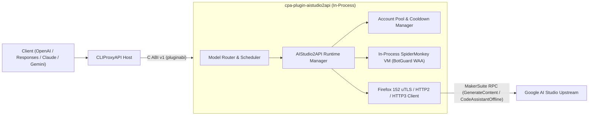

# cpa-plugin-aistudio2api (AIStudio2API for CLIProxyAPI)

<p align="center">
  <a href="./README.md">简体中文</a> | <strong>English</strong>
</p>

<p align="center">
  <a href="https://github.com/Mag1cFall/AIStudio2API"></a>
  <a href="https://github.com/router-for-me/CLIProxyAPI"></a>
  <a href="./LICENSE"></a>
</p>

> **Upstream Attribution & Acknowledgements**  
> This repository is a native **[CLIProxyAPI](https://github.com/router-for-me/CLIProxyAPI)** dynamic-library plugin port (C ABI v1 / Schema v10) of **[Mag1cFall/AIStudio2API](https://github.com/Mag1cFall/AIStudio2API)**.  
> The core Google AI Studio protocol stack (MakerSuite `GenerateContent`, Build `CodeAssistantOffline`, Firefox/uTLS fingerprint spoofing, in-process SpiderMonkey BotGuard WAA VM, multi-account cooldown scheduling, and multi-protocol translation) originates from **[Mag1cFall/AIStudio2API](https://github.com/Mag1cFall/AIStudio2API)** under the [MIT License](./LICENSE).

> [!WARNING]
> **Security Notice: Why `-build` Code-Assistant Models Were Removed in `v1.2.4`**  
> Starting in `v1.2.4` (synced with upstream [`Mag1cFall/AIStudio2API@a68acad`](https://github.com/Mag1cFall/AIStudio2API/commit/a68acad8b56619a8bef7802131db595ee5d11b6a) and [#11](https://github.com/jianli9158/cpa-plugin-aistudio2api/issues/11)), **all `-build` code-assistant (Applet) models** (such as `gemini-3.8-flash-build` and `gemini-3.1-pro-preview-build`) have been **completely removed**:
> 1. **How `-build` Applet Models Worked**: Under the hood, `-build` models invoked `CreateApplet` / `SaveApplet` to repeatedly create `"Untitled"` AI Studio Applets in the account's Google Drive and injected prompt overrides to hijack the Applet's internal file-editing tools for general function calling.
> 2. **Google AI Studio Applet Ban Wave**: Google recently tightened automated abuse and malware scanning on AI Studio Applets. When `-build` models were used with coding agents (such as Claude Code, Codex, or Cline), agent system prompts, shell commands, and code payloads uploaded into Applets frequently tripped Google's safety filters—resulting in permanent AI Studio account suspensions (`servicerestricted`).
> 3. **Recommended Alternative**: Use standard **Playground channel models** without the `-build` suffix (e.g., `gemini-3.8-flash`, `gemini-4-argon`, `gemini-3.1-pro-preview`). Playground models support native Function Calling, thinking levels (`-minimal` / `-low` / `-medium` / `-high` / `-xhigh` / `-max`), and automatic tool-call continuation without creating Drive Applets.

---
## Key Features

- **In-Process SpiderMonkey BotGuard WAA Engine**: Statically links the Firefox 152 SpiderMonkey C++ engine directly into the plugin shared library (`.dylib` / `.so` / `.dll`), executing Google BotGuard WAA bytecode and generating fresh proofs in milliseconds inside the CLIProxyAPI process—no Python, Node.js, Playwright, or headless browser required.
- **Full Playground + Build Channel Support**:
  - **Playground Channel** (`MakerSuiteService/GenerateContent`): Supports `gemini-3.8-flash`, `gemini-4-argon`, `gemini-2.5-pro`, `gemini-2.5-flash`, Imagen, Veo, TTS, Decision, and thinking-level suffixes (`-minimal` / `-low` / `-medium` / `-high` / `-xhigh` / `-max`).
  - **Build Proxy Channel**: Retains the legacy Build proxy channel and optional frontend hidden-model discovery (`-build` code-assistant applet models have been removed for account safety).
- **Native 4-Protocol Input/Output**: Accepts and streams `chat-completions` (OpenAI Chat), `responses` (OpenAI Responses), `anthropic` (Claude Messages), and `gemini` (Google Gemini Native) formats.
- **Complete CLIProxyAPI Plugin Capabilities (All 9 Interfaces)**:
  1. `auth_provider`: Supports clicking **"Start Login"** directly in the ECPA / CPA OAuth dashboard (`auth.login_start` / `auth.login_poll`) to launch an isolated local Chrome window and auto-capture credentials, syncing 1-to-1 with `~/.cli-proxy-api/aistudio2api-<email>.json`.
  2. `model_provider`: Static + per-credential dynamic discovery of Playground & hidden model catalogs.
  3. `model_router`: Routes both prefixed (`aistudio/<model>`) and unprefixed (`gemini-3.8-flash`, `gemini-4-argon`) model requests.
  4. `scheduler`: Delegates to AIStudio2API's tier-aware (Paid / Free), restricted-account-aware, concurrency-aware, and cooldown-aware `AccountPool`.
  5. `executor`: Synchronous & streaming generation, automatic tool-call continuation, local SentencePiece + upstream `CountTokens`, and multimodal media handling.
  6. `request_lifecycle_plugin`: Tracks request completion and upstream status codes.
  7. `quota_provider`: Reports account benefit tiers, available model counts, and cooldown recovery timers in the CPA dashboard with one-click reset.
  8. `command_line_plugin`: Adds `--aistudio2api-status` and `--aistudio2api-login` CLI flags.
  9. `management_api` + Embedded Web Console (`/v0/resource/plugins/aistudio2api/accounts`): Single-button service start/stop toggle, local isolated Chrome login, Cookie/StorageState account import, cooldown management, and live logs.
---

## Architecture



---

## Installation

### Option 1: Install from CLIProxyAPI Plugin Store (Recommended)
Open the CLIProxyAPI Management Center (or EasyCLIProxyAPI desktop app), navigate to **Plugins -> Store**, search for **`AIStudio2API`** (`aistudio2api`), and click **Install**.

### Option 2: Download Prebuilt Binary from GitHub Releases
1. Download the archive for your platform from [Releases](https://github.com/jianli9158/cpa-plugin-aistudio2api/releases):
   - macOS Apple Silicon: `aistudio2api_1.2.4_darwin_arm64.zip`
   - macOS Intel: `aistudio2api_1.2.4_darwin_amd64.zip`
   - Linux x86_64: `aistudio2api_1.2.4_linux_amd64.zip`
   - Linux ARM64: `aistudio2api_1.2.4_linux_arm64.zip`
   - Windows x86_64: `aistudio2api_1.2.4_windows_amd64.zip`
   - Windows ARM64: `aistudio2api_1.2.4_windows_arm64.zip`
2. Extract the dynamic library (`aistudio2api.dylib` / `aistudio2api.so` / `aistudio2api.dll`) into CLIProxyAPI's plugin directory:
   ```text
   plugins/<goos>/<goarch>/aistudio2api.{dylib,so,dll}
   ```

### Option 3: Build from Source
#### Prerequisites
- Go 1.27+ with `CGO_ENABLED=1`
- C/C++ compiler (macOS: Xcode Command Line Tools; Linux: GCC/Clang; Windows: MinGW-w64 / LLVM-MinGW)

#### Build Commands
```bash
git clone https://github.com/jianli9158/cpa-plugin-aistudio2api.git
cd cpa-plugin-aistudio2api

# Automatically downloads SpiderMonkey static library and builds into dist/plugins/<goos>/<goarch>/
make build

# Run unit tests and dlopen C ABI integration tests
make test
```

---

## Configuration (`config.yaml`)

Enable the plugin in CLIProxyAPI's `config.yaml`:

```yaml
plugins:
  enabled: true
  dir: "plugins"
  configs:
    aistudio2api:
      enabled: true
      waa_backend: "spidermonkey"
      data_dir: "~/.aistudio2api"
      proxy: ""
      warm_workers: 2
      max_active_workers: 5
      per_account_concurrency: 2
      route_unprefixed_models: true
      sync_auth_files: true
      fake_stream: false
      model_aliases: ""
```

| Field | Type | Default | Description |
| :--- | :---: | :---: | :--- |
| `waa_backend` | `enum` | `"spidermonkey"` | BotGuard WAA runtime engine (in-process `"spidermonkey"` VM, no external browser needed) |
| `data_dir` | `string` | `"~/.aistudio2api"` | Directory storing internal account state, WAA cache, and model catalogs (kept outside `~/.cli-proxy-api` so internal JSON files are not scanned as credentials) |
| `proxy` | `string` | `""` | Optional upstream proxy URL (`http://`, `https://`, `socks5://`) for Google AI Studio traffic |
| `warm_workers` | `int` | `2` | Number of pre-warmed WAA workers |
| `max_active_workers` | `int` | `5` | Maximum concurrent active WAA workers |
| `per_account_concurrency` | `int` | `2` | Maximum concurrent generation requests per Google account |
| `route_unprefixed_models` | `bool` | `true` | Route unprefixed AI Studio models (`gemini-3.8-flash`, `gemini-4-argon`, etc.) while honoring per-account and global `excluded_models` |
| `sync_auth_files` | `bool` | `true` | Automatically sync/remove 1-to-1 `aistudio2api-<email>.json` files in `~/.cli-proxy-api/` while preserving host-managed fields (`excluded_models`, `model_aliases`, `prefix`, `priority`, `weight`, etc.) |
| `fake_stream` | `bool` | `false` | Collect full response upstream via non-streaming RPC before streaming events to the client |
| `model_aliases` | `string` | `""` | Comma-separated model aliases in `alias:target` or `alias=target` format (e.g. `my-argon:gemini-4-argon,my-flash:gemini-3.8-flash-preview`) |
| `account_order` | `string` | `""` | Priority account order under `fill-first` routing strategy (comma- or space-separated account email IDs) |
| `max_account_switches` | `int` | `3` | Maximum additional accounts to try per request on quota/transient errors (`0` disables account switching) |
| `discover_hidden_models` | `bool` | `false` | Probe and include unreleased hidden models from the AI Studio frontend bundle |
| `model_accounts` | `string` | `""` | Comma-separated model-to-account bindings in `model:account1\|account2` format (e.g. `gemini-3.1-pro-preview:a@gmail.com\|b@gmail.com`) |
| `upstream_channels` | `[]string` | `["playground"]` | Enabled upstream channels (defaults to `["playground"]`; set to `["playground", "build"]` to also enable Build proxy channel) |
| `first_event_hedge` | `string` | `"auto"` | First-event timeout backup request hedging policy (`auto` adapts to recent latency, or duration like `"6s"`, `off` to disable) |
| `first_event_hedge_models` | `string` | `"gemini-4-argon"` | Target models for first-event hedging (comma-separated, `*` for all models) |

---

## Excluded Models & Model Aliases

### 1. Excluded Models (`excluded-models`)
The plugin uses `ExecutorModelScopeOAuth` so published models are strictly bound to enabled account credentials and respect both per-credential and global exclusions:
- **Option A (Per-Credential GUI)**: In EasyCLIProxyAPI **Credentials**, edit an `aistudio2api` credential and add model names or wildcards (e.g. `gemini-2.5-flash*`, `*tts*`) under **Excluded Models**.
- **Option B (Global `config.yaml`)**:
  ```yaml
  oauth:
    excluded-models:
      aistudio2api:
        - "gemini-2.5-flash-preview-tts"
        - "imagen-*"
  ```

### 2. Model Aliases (`model_aliases` / `model-alias`)
> **Note**: EasyCLIProxyAPI's **Advanced Features -> Model Aliases** UI currently hardcodes its OAuth channel selector to 9 built-in channels on the client side and does not list third-party plugin catalogs directly. You can configure `aistudio2api` model aliases using any of the **3 methods** below—configured aliases are registered in `/v1/models` and appear in EasyCLIProxyAPI's **Agent Configuration** model selector:

- **Option A (Recommended: Plugin `model_aliases` setting)**:  
  Set `model_aliases` in **Plugins -> AIStudio2API -> Settings** (or under `plugins.configs.aistudio2api.model_aliases` in `config.yaml`) using comma-separated `alias:target` (or `alias=target`) pairs:
  ```yaml
  plugins:
    configs:
      aistudio2api:
        model_aliases: "my-argon:gemini-4-argon,my-flash:gemini-3.8-flash-preview"
  ```
- **Option B (Global `oauth.model-alias` in `config.yaml`)**:
  ```yaml
  oauth:
    model-alias:
      aistudio2api:
        - name: "gemini-4-argon"
          alias: "my-argon"
          fork: true
  ```
- **Option C (Per-Credential JSON `~/.cli-proxy-api/aistudio2api-<email>.json`)**:
  ```json
  "model_aliases": {
    "my-argon": "gemini-4-argon"
  }
  ```
---

## Account Login & Import Guide

When CLIProxyAPI starts, the plugin **automatically starts and pre-warms** in the background. You can add Google AI Studio accounts in three ways:

### Method 1: Click "Start Login" Directly in ECPA / CPA Dashboard (Easiest)
1. In EasyCLIProxyAPI (or the CLIProxyAPI Management Center), go to the **OAuth Login** or **Plugins** page, find **`AIStudio2API`**, and click **"Start Login"**.
2. The plugin immediately launches an **isolated local Chrome / Edge / Brave window** in the background (using a temporary `--user-data-dir` with Blink `AutomationControlled` disabled so it never reads your existing browser profiles or OS keychains, and passes Google Sign-In without triggering *"This browser or app may not be secure"*).
3. Sign in to your Google account and reach AI Studio; the plugin automatically captures the isolated session's credentials, closes the window, cleans up the temporary directory, and completes the login in ECPA.

### Method 2: Login or Relogin from the Embedded Plugin Console
Open the embedded plugin console (`http://127.0.0.1:8317/v0/resource/plugins/aistudio2api/accounts`, or click **Plugins -> AI Studio (WAA)** in the sidebar):
- Click **🌐 Launch Local Chrome Incognito Login** (or run `cli-proxy-api --aistudio2api-login`) to sign in via an isolated browser window;
- Click **Incognito Relogin** on any existing account row to refresh expired credentials.

### Method 3: Cookie / StorageState Import (For Headless / Remote Servers)
Paste a browser request Cookie header (containing `SAPISID` and `__Secure-1PSID`), a Cookie-Editor JSON array, or a Playwright `storage-state.json` document in the plugin console and click **Import Cookie / StorageState Account**.

---

## API Request Examples

```bash
# Playground channel model (gemini-3.8-flash)
curl http://127.0.0.1:8317/v1/chat/completions \
  -H "Authorization: Bearer YOUR_CPA_API_KEY" \
  -H "Content-Type: application/json" \
  -d '{
    "model": "gemini-3.8-flash",
    "messages": [{"role": "user", "content": "Hello!"}],
    "stream": true
  }'

# Extra-high thinking level model (gemini-4-argon-xhigh)
curl http://127.0.0.1:8317/v1/chat/completions \
  -H "Authorization: Bearer YOUR_CPA_API_KEY" \
  -H "Content-Type: application/json" \
  -d '{
    "model": "gemini-4-argon-xhigh",
    "messages": [{"role": "user", "content": "Hello!"}],
    "stream": true
  }'
```

---

## License

Released under the **[MIT License](./LICENSE)**:
- Original project copyright: **[Mag1cFall/AIStudio2API](https://github.com/Mag1cFall/AIStudio2API)** (`Copyright (c) 2026 Mag1cFall`).
- CLIProxyAPI native plugin port copyright: `Copyright (c) 2026 jianli9158`.
